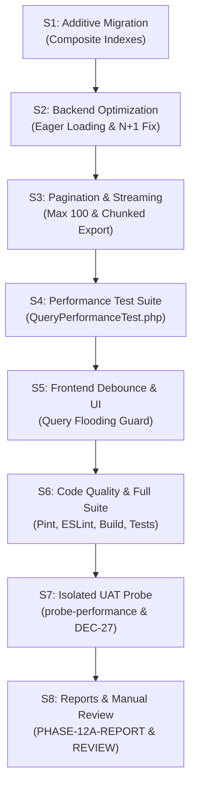

# Rencana Kerja Fitur — Subfase 12a (Pagination, Query Performance, dan Pengendalian Beban)

## 1. Ringkasan Eksekutif & Status Rencana

- **Subfase:** 12a — Pagination, Query Performance, dan Pengendalian Beban (*Database Query Optimization, Eager Loading, Composite Indexing & Memory-Safe Streaming*).
- **Milestone Induk:** Fase 12 — Performa, Observability dan Konsistensi.
- **Usulan Keputusan Arsitektur:** **DEC-45 APPROVED (D1–D10)** pada 2026-11-03 WIB.
- **Baseline Kode:** `main` pada commit [`9a7eeb6`](file:///D:/xampp-htdocs/app-administration_school) (pencatatan penerimaan pemilik Subfase 11c `#1–#18` dan penutupan resmi Fase 11).
- **Status Rencana:** **PLAN — APPROVED (DEC-45: D1–D10)** berdasarkan instruksi tertulis pemilik: *"Saya setuju D1-D10"*.
- **Status Implementasi:** **IN PROGRESS (S1–S8)** (sedang dieksekusi).

---

## 2. Konteks & Latar Belakang Kebutuhan

Sepanjang penyelesaian Fase 01 hingga Fase 11, aplikasi sekolah telah berhasil membangun seluruh pilar domain operasional fungsional:
- **Fase 01–06 (Fondasi & Kesiswaan):** Manajemen akses multi-peran, backup terenkripsi, data induk kesiswaan, kepegawaian, impor/ekspor CSV, serta siklus tahun ajaran dan mutasi siswa.
- **Fase 07–09 (Administrasi Terpadu):** Persuratan masuk/keluar berdisposisi & penomoran atomik, perizinan siswa/pegawai, dan repositori arsip dokumen berversi dengan audit akses.
- **Fase 10–11 (Pembelajaran, Analitik & Tugas):** Penjadwalan pelajaran 3D bebas bentrok, pencatatan jurnal mengajar, laporan kepatuhan guru, dashboard adaptif peran, laporan demografi multi-tahun, rekonsiliasi berkas Dapodik, dan pusat tugas operasional terpadu.

Seiring pertumbuhan volume data operasional (ribuan siswa, ratusan pegawai, ribuan riwayat jadwal/jurnal, arsip dokumen, serta surat/izin), tantangan performa dan beban server menjadi fokus utama:
1. **Pencegahan Masalah N+1 Query:** Pada endpoint-endpoint daftar (*list endpoints*), pemuatan relasi Eloquent tanpa strategi *eager loading* yang tepat dapat memicu puluhan hingga ratusan kueri SQL tambahan ke basis data untuk satu request halaman (contoh: kueri kelas rombel siswa, status kepegawaian, lampiran surat, atau profil akun tertaut).
2. **Ketiadaan Indeks Komposit pada Kueri Multi-Kondisi:** Filter pencarian harian sering kali menggabungkan beberapa kolom sekaligus (misalnya `[school_year_id, status]`, `[direction, status, workflow_status]`, `[subject_type, status]`, `[teaching_schedule_id, session_date]`). Tanpa indeks komposit yang tepat, database melakukan *full-table scan* yang memperlambat waktu respon ketika tabel membesar.
3. **Standarisasi Kontrak Paginasi Server-Side:** Seluruh endpoint daftar harus secara konsisten membatasi ukuran halaman (`per_page` default 15/25, batas keras maksimal 100 item) agar tidak membebani memori PHP maupun transfer jaringan klien.
4. **Keamanan Memori pada Ekspor Berkas Skala Besar (Memory-Safe Streaming):** Proses ekspor data (CSV) untuk ribuan siswa atau riwayat rekapitulasi tidak boleh memuat seluruh baris ke dalam array memori sekaligus (`Collection::all()`), melainkan wajib menggunakan generator atau kueri bertahap (*chunking/streaming*) via `cursor()` atau `chunk(250)` agar tidak memicu *PHP Fatal Error: Out of Memory*.
5. **Pencegahan Kebocoran Cache Lintas Peran (*Cross-Role Cache Leak*):** Apabila caching query diterapkan, *cache key* wajib terisolasi secara ketat per wewenang pengguna (misal menyertakan `user_id` atau cakupan peran), sehingga data privat tidak bocor kepada akun dengan peran lebih rendah.

---

## 3. Usulan Keputusan Pemilik (DEC-45: D1–D10)

Berikut 10 butir usulan keputusan arsitektur untuk Subfase 12a:

### D1 — Cakupan Subfase 12a & Batasan Non-Goals
Kerjakan **Subfase 12a: Pagination dan Query** saja. Fokus utama:
1. Audit dan eliminasi masalah N+1 query pada seluruh endpoint daftar aktif.
2. Migrasi aditif penambahan indeks komposit database pada tabel-tabel berkueri tinggi.
3. Standarisasi parameter paginasi server-side dan batas kuota `per_page` maksimal 100.
4. Optimalisasi penggunaan memori streaming pada proses ekspor data CSV.
5. Penerapan debounce seragam (300 ms) pada antarmuka pencarian frontend untuk mencegah *query flooding*.
6. Pengukuran *query budget* terukur ($\le 5$ SQL per list sederhana, $\le 10$ SQL per agregasi) dan suite tes otomatis performa kueri.
- **Non-Goals:**
  - Tidak melakukan perombakan arsitektur worker/antrean (*background job*) atau penanganan error correlation ID (dijadwalkan pada Subfase 12b).
  - Tidak melakukan pembersihan menu/styling demo UI Sakai PrimeVue yang tidak terpakai (dijadwalkan pada Subfase 12c).
  - Tidak melakukan upgrade versi mayor Laravel atau Vue.
  - Tetap mematuhi DEC-27 (server UAT dihentikan setelah pengujian, port 18028/14028 bebas).

### D2 — Audit & Eliminasi N+1 Problem pada Seluruh Endpoint Aktif
Menerapkan *eager loading* terencana (`with([...])`) dengan relasi selektif (*constrained select*) pada model-model utama:
- **Kesiswaan (`StudentController`):** Memuat relasi rombel aktif (`activeStudentRombel.schoolRombel`), jenjang, dan bantuan sosial kesiswaan secara terpadu tanpa kueri tambahan per baris.
- **Kepegawaian (`EmployeeController`):** Memuat relasi jenis pegawai, status kepegawaian, dan akun login tertaut (`user:id,name,username,email,status_user_id`).
- **Jadwal & Pembelajaran (`TeachingScheduleController`, `TeachingSessionJournalService`):** Memuat relasi rombel, mata pelajaran, profil guru `Pendidik`, serta jadwal induk secara efisien.
- **Persuratan (`LetterController`):** Memuat lampiran aktif, riwayat peninjauan (*approvals*), disposisi terbuka, dan data pejabat penandatangan dalam satu kueri agregat.
- **Perizinan (`LeaveController`):** Memuat subjek siswa/pegawai dan keputusan permohonan terakhir.
- **Arsip Dokumen (`ArchiveController`):** Memuat versi berkas terkini (`latestVersion`) dan metadata kategori tanpa pengulangan kueri.
- **Tugas Operasional (`OperationalTaskController`):** Memuat relasi staf pembuat dan staf penyelesai tugas.

### D3 — Migrasi Aditif Indeks Komposit Database
Menyediakan migrasi baru `2029_12_01_000001_add_performance_composite_indexes.php` untuk menambahkan indeks komposit terukur pada tabel dengan volume kueri tinggi:
- `students`: `INDEX (school_year_id, status_id)` dan `INDEX (nisn)` / `INDEX (nik)`
- `student_rombels`: `INDEX (school_year_id, school_rombel_id, status)`
- `employees`: `INDEX (user_id, status_id)` dan `INDEX (nuptk)`
- `teaching_schedules`: `INDEX (school_year_id, semester_id, day_of_week)` dan `INDEX (employee_id, day_of_week)`
- `teaching_journals`: `INDEX (session_date, teaching_schedule_id)`
- `letters`: `INDEX (direction, status, workflow_status)` dan `INDEX (received_date)`
- `letter_dispositions`: `INDEX (letter_id, recipient_employee_id, status)`
- `leave_requests`: `INDEX (subject_type, status, start_date)`
- `archive_documents`: `INDEX (category, is_active, valid_until)`
- `operator_reminders`: `INDEX (status, priority, due_date)` dan `INDEX (system_source_key)`

### D4 — Standardisasi Kontrak Paginasi Server-Side
Menyeragamkan validasi dan parameter paginasi di seluruh endpoint:
- Parameter yang didukung: `page` (integer, min: 1, default: 1) dan `per_page` (integer, min: 1, max: 100, default: 15 atau 25).
- Struktur response paginasi standar:
  ```json
  {
    "success": true,
    "data": [ ... ],
    "pagination": {
      "current_page": 1,
      "per_page": 25,
      "total": 120,
      "total_pages": 5
    }
  }
  ```
- Menolak nilai `per_page > 100` dengan validasi otomatis `422 Unprocessable Entity` untuk mencegah *resource exhaustion*.

### D5 — Pengendalian Memori Ekspor & Streaming Respons
Seluruh endpoint ekspor CSV (Siswa, Pegawai, Mutasi, Jurnal Mengajar, Statistik Multi-Tahun, dan Rekonsiliasi Dapodik) wajib memenuhi kaidah *memory-safe streaming*:
- Menggunakan `StreamedResponse` dengan *generator function* atau kueri bertahap `chunk(250)` / `cursor()`.
- Penggunaan memori puncak (*peak memory usage*) saat ekspor dibatasi $\le 64$ MB terlepas dari jumlah baris yang diekspor.
- Seluruh berkas ekspor tetap mempertahankan standar UTF-8 BOM (`\xEF\xBB\xBF`) dan sanitasi formula spreadsheet (`=`, `+`, `-`, `@`).

### D6 — Standar Batas Kueri (*Query Budget*) & Target Latensi
Menetapkan kriteria keberhasilan kinerja terukur (*query budget*):
- **Endpoint Daftar Sederhana (Simple List):** Maksimal **$\le 5$ kueri SQL** per request (1 kueri count/total, 1 kueri data utama, 1–3 kueri eager loading relasi).
- **Endpoint Agregasi & Dashboard:** Maksimal **$\le 10$ kueri SQL** per request.
- **Target Waktu Respons Server (Backend Execution Time):** $\le 150$ ms pada database SQLite/MariaDB dengan dataset operasional normal ($\ge 1.000$ baris).

### D7 — Kebijakan Isolasi Cache & Pencegahan Cross-Role Cache Leak
- Data yang dipengaruhi oleh hak akses pengguna (*permission-scoped data*) **dilarang menggunakan kunci cache global**.
- Kunci cache (bila digunakan) wajib menyertakan identitas aktor atau token cakupan hak akses, misalnya: `cache:dashboard:overview:user_{id}` atau `cache:tasks:summary:role_{role_slug}`.
- Cache wajib memiliki masa berlaku terukur (*TTL $\le 5$ menit*) dan mekanisme *invalidation* saat terjadi mutasi data terkait.

### D8 — Suite Pengujian Otomatis Performa (`QueryPerformanceTest.php`)
Membangun test suite khusus di `laravel-api/tests/Feature/Performance/QueryPerformanceTest.php` yang memverifikasi:
- Tidak ada kueri duplikat berulang (*N+1 check*) saat jumlah record bertambah dari 5 menjadi 25 item (kueri SQL konstan / $O(1)$ terhadap ukuran data).
- Validasi kepatuhan paginasi: `per_page=100` diterima, `per_page=101` ditolak 422.
- Pengukuran batas kueri pada 10 endpoint utama: Siswa, Pegawai, Rombel, Jadwal, Jurnal, Surat Masuk, Surat Keluar, Izin, Arsip, dan Tugas Operasional.

### D9 — Standardisasi Frontend Debounce & Paginasi Tabel
- Memastikan seluruh komponen pencarian teks pada tabel Vue (`Student.vue`, `EmployeeDirectory.vue`, `TeachingJournalsView.vue`, `IncomingLetters.vue`, `OutgoingLetters.vue`, `Leaves.vue`, `Archives.vue`, `TasksView.vue`) menggunakan *debounce* seragam 300–400 ms atau pemicu tombol Enter/klik.
- Mencegah pengiriman request API beruntun pada setiap penekanan tombol (*keystroke*).

### D10 — UAT Terisolasi & Kepatuhan DEC-27
- Memperluas skrip pengujian UAT di `laravel-api/scripts/phase10-uat.php` dengan handler perintah baru: `probe-performance`.
- Perintah ini akan menguji eksekusi kueri, mencatat waktu respon (ms), mengukur query count pada endpoint utama, dan memverifikasi ketiadaan N+1 problem secara otomatis.
- Setelah pengujian UAT selesai, server UAT pada port `18028` dan `14028` wajib dipastikan dihentikan dan port bebas listener per DEC-27.

---

## 4. Rencana Langkah Pelaksanaan (S1–S8)

Berikut tahapan teknis implementasi setelah keputusan D1–D10 disetujui pemilik:



- **S1: Additive Migration Indeks Komposit:** Membuat migration `2029_12_01_000001_add_performance_composite_indexes.php` dengan indeks komposit pada tabel-tabel utama.
- **S2: Optimasi Eager Loading Backend:** Mengaudit dan menerapkan `with(...)` pada seluruh repository/service/controller aktif untuk mengeliminasi N+1 query.
- **S3: Standardisasi Paginasi & Memory-Safe Export:** Mengunci validasi `per_page <= 100` dan menerapkan `chunk(250)` / `cursor()` pada seluruh streaming CSV.
- **S4: Pembuatan Feature Test Kueri:** Menulis `laravel-api/tests/Feature/Performance/QueryPerformanceTest.php` mencakup 10 skenario budget kueri.
- **S5: Optimasi Input Pencarian Frontend:** Menerapkan debounce 300ms pada seluruh input filter pencarian di komponen Vue utama.
- **S6: Verifikasi Mutu & Regresi Penuh:** Menjalankan Laravel Pint, ESLint, Vite build, dan suite tes penuh backend (`php artisan test`).
- **S7: Eksekusi UAT Terisolasi & Kepatuhan DEC-27:** Menambahkan dan menjalankan `php scripts/phase10-uat.php probe-performance` (5/5 PASS), serta memverifikasi port 18028/14028 bebas listener.
- **S8: Dokumentasi & Penyerahan Paket:** Menyusun `reports/feature-update/PHASE-12A-REPORT.md` dan checklist review manual pemilik `PHASE-12A-MANUAL-REVIEW.md` (#1–#18).

---

## 5. Matriks Verifikasi & Kriteria Keberhasilan

| No | Target Verifikasi | Ambang Batas / Kriteria Sukses |
|:--:|---|---|
| **1** | Simple List Query Count | $\le 5$ kueri SQL per pemanggilan endpoint daftar berpaginasi |
| **2** | Aggregated Query Count | $\le 10$ kueri SQL per pemanggilan endpoint dashboard / overview |
| **3** | N+1 Scaling Invariance | Kueri SQL tidak bertambah saat jumlah data per halaman dinaikkan dari 5 ke 25 item |
| **4** | Paginasi Hard Limit | Request `per_page=100` sukses (200 OK); request `per_page=101` ditolak validasi (422) |
| **5** | Memory-Safe CSV Export | Ekspor dataset $\ge 1.000$ baris mengonsumsi memori puncak $\le 64$ MB |
| **6** | Response Time Latency | Backend query execution time $\le 150$ ms pada dataset normal |
| **7** | Cross-Role Cache Safety | Tidak ada kebocoran data sensitif antar role saat caching aktif |
| **8** | Frontend Debounce Guard | Input pencarian menunda request minimal 300 ms saat pengetikan cepat |
| **9** | Full Test Suite Regression | 0 failures, 0 regressions pada seluruh 678+ tes backend |
| **10** | Port Isolation (DEC-27) | Port 18028 dan 14028 bebas listener setelah pengujian selesai |

---

## 6. Pertanyaan Persetujuan Pemilik

Mohon ditinjau 10 butir usulan keputusan arsitektur di atas (**D1–D10**).  
Jika Anda setuju dengan seluruh rancangan ini, silakan sampaikan persetujuan Anda:

> **"Saya setuju D1-D10"**

Setelah persetujuan Anda diterima, kami akan mencatat keputusan tersebut sebagai **DEC-45 APPROVED** dan langsung memulai implementasi Subfase 12a sesuai langkah S1–S8.
