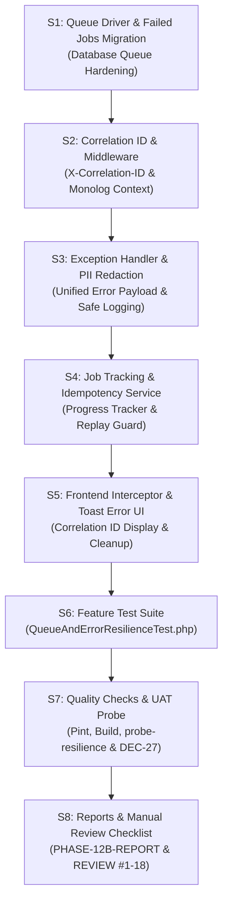

# Rencana Kerja Fitur — Subfase 12b (Background Jobs, Queue Resilience, Observability & Error Handling)

## 1. Ringkasan Eksekutif & Status Rencana

- **Subfase:** 12b — Background Jobs, Queue Resilience, Observability dan Error Handling (*Worker/Scheduler, Retry/Idempotency, Correlation ID & Secure Observability*).
- **Milestone Induk:** Fase 12 — Performa, Observability dan Konsistensi.
- **Usulan Keputusan Arsitektur:** **DEC-46 PROPOSED (D1–D10)** pada 2026-11-03 WIB.
- **Baseline Kode:** `main` setelah penyelesaian Subfase 12a (*Pagination, Query Performance & Hard-Limit*).
- **Status Rencana:** **PLAN — PROPOSED (DEC-46: D1–D10)** — *Menunggu Persetujuan Pemilik*.
- **Status Implementasi:** **NOT STARTED** (menunggu instruksi tertulis persetujuan D1–D10 dari pemilik).

---

## 2. Konteks & Latar Belakang Kebutuhan

Dengan diselesaikannya Subfase 12a yang mengoptimasi query database, indeks komposit, eager loading, dan batas keras paginasi (`per_page <= 100`), sistem kini memiliki fondasi data retrieval yang kokoh dan efisien ($O(1)$ query scaling).

Namun demikian, aspek **pemrosesan tugas latar belakang (background jobs), ketahanan kegagalan (resilience), dan observabilitas kesalahan (observability & exception handling)** memerlukan standarisasi menyeluruh untuk memastikan keandalan operasional tingkat produksi:
1. **Pemisahan Operasi Berat dari Siklus Request-Response HTTP:** Operasi-operasi berat seperti pembuatan berkas cadangan terenkripsi (*backup dump*), impor massal ratusan data kesiswaan/kepegawaian, rekonsiliasi data Dapodik berskala besar, serta pengiriman notifikasi/pengingat terjadwal rentan mengalami *HTTP Request Timeout* jika diproses secara sinkron pada siklus web server.
2. **Kebutuhan Mekanisme Retry & Dead-Letter Queue (Failed Jobs):** Pekerjaan latar belakang (*queue jobs*) yang mengalami kegagalan sementara (*transient failures*, misal I/O disk sesaat atau lock database) harus memiliki strategi percobaan ulang (*retry*) yang terkontrol dengan *exponential backoff*, serta pencatatan terstruktur ke tabel `failed_jobs` tanpa mematikan proses worker secara mendadak.
3. **Idempotensi & Pencegahan Eksekusi Ganda (Replay Protection):** Operasi yang memutasi status sistem (misal komit progres kesiswaan atau pemrosesan batch perizinan) wajib memiliki *idempotency key* atau lock guard sehingga jika pengguna melakukan klik ganda atau terjadi retry otomatis oleh worker, sistem tidak memproses data dua kali (*duplicate side-effects*).
4. **Visibilitas Status & Progres Pekerjaan (*Job Progress Tracking*):** Pengguna antarmuka (SPA) membutuhkan indikator progres yang jelas (misal: *persentase 0–100%*, *status: pending/processing/completed/failed*) saat menjalankan proses panjang, daripada layar yang tampak menggantung tanpa umpan balik.
5. **Observabilitas Terpadu dengan Correlation ID yang Aman:** Setiap kesalahan teknis di backend harus dapat dilacak dengan mudah oleh tim administrator tanpa harus membongkar seluruh log server. Penggunaan `Correlation ID` (UUID) pada setiap request dan job log memungkinkan penelusuran akar masalah secara instan.
6. **Perlindungan Data Pribadi (PII) pada Seluruh Log:** Berkas log aplikasi (`laravel.log`) dan pesan kesalahan teknis dilarang keras mencatat data pribadi sensitif siswa/pegawai (seperti NIK, NISN, tanggal lahir, nama ibu, kata sandi, atau token otentikasi) guna mematuhi prinsip *privacy-by-design*.
7. **Pembersihan *Global Console Suppression* di Frontend SPA:** Blok penanganan kesalahan pada klien Vue tidak boleh menelan kegagalan (*swallowing errors*) secara diam-diam (`catch (e) {}` kosong) atau mencetak informasi mentah ke console browser. Seluruh kegagalan jaringan/server wajib ditangani secara anggun dengan komponen pesan/toast yang informatif dan memuat nomor referensi kesalahan (*Correlation ID*).

---

## 3. Usulan Keputusan Pemilik (DEC-46: D1–D10)

Berikut 10 butir usulan keputusan arsitektur terinci untuk Subfase 12b:

### D1 — Cakupan Subfase 12b & Batasan Non-Goals
Kerjakan **Subfase 12b: Job dan Error** saja. Fokus utama:
1. Konfigurasi dan hardening antrean latar belakang (*database queue driver*) dengan batas percobaan, timeout, dan penanganan failed jobs.
2. Mekanisme idempotensi dan replay guard untuk pekerjaan berat (impor, backup, mutasi batch).
3. Pembuatan API pemantauan status dan progres pekerjaan latar belakang (`/api/jobs/status/{job_id}`).
4. Standarisasi format exception handling global di backend dengan penyematan header `X-Correlation-ID`.
5. Kebijakan sanitasi data pribadi (PII redaction) pada seluruh saluran logging monolog/Laravel.
6. Pembersihan pembungkaman error (*console suppression*) di frontend Vue dan standarisasi penanganan error berbasis Toast UI dengan referensi Correlation ID.
7. Suite pengujian otomatis ketahanan antrean dan penanganan kesalahan (`QueueAndErrorResilienceTest.php`).
- **Non-Goals:**
  - Tidak merombak menu demo atau styling visual antarmuka pengguna Sakai PrimeVue (dijadwalkan pada Subfase 12c).
  - Tidak melakukan upgrade versi mayor Laravel atau Vue.
  - Tetap mematuhi aturan DEC-27 (server UAT dihentikan setelah pengujian, port 18028/14028 bebas).

### D2 — Konfigurasi Driver Antrean & Manajemen Failed Jobs
- Mengonfigurasi antrean aplikasi berbasis database (`QUEUE_CONNECTION=database`) yang kompatibel di lingkungan SQLite maupun MariaDB.
- Memastikan tabel migrasi pendukung `jobs` dan `failed_jobs` tersedia secara bersih dan terisolasi.
- Menetapkan parameter default eksekusi worker:
  - *Max Attempts:* Maksimal **3 kali percobaan**.
  - *Backoff Delay:* Eksponensial bertahap (**5 detik**, **15 detik**, **60 detik**).
  - *Job Timeout:* Batas waktu maksimal eksekusi **120 detik** per pekerjaan; pekerjaan yang melampaui timeout otomatis dialihkan ke status gagal untuk mencegah *zombie worker*.
- Menyediakan perintah artisan aman untuk inspeksi failed jobs (`queue:failed`, `queue:retry`, `queue:forget`) tanpa mengekspos data kredensial.

### D3 — Idempotensi & Replay Guard pada Heavy Operations
- Setiap pekerjaan yang berdampak mutasi data (misal proses impor data induk siswa/pegawai atau commit mutasi kesiswaan) wajib memanfaatkan *Idempotency Key* berbasis UUID atau hashing parameter unik:
  - Pekerjaan yang menerima kunci idempotensi yang sama dalam status *processing* atau *completed* dilarang dieksekusi ulang.
  - Jika klien mengirim request ulang, sistem mengembalikan status pekerjaan yang sedang/telah berjalan (*replay response*) tanpa memicu mutasi ganda.

### D4 — Standarisasi Correlation ID pada Siklus Request & Job
- Membuat middleware backend `EnsureCorrelationId`:
  - Setiap request HTTP masuk yang belum memiliki header `X-Correlation-ID` akan secara otomatis di-generate-kan UUIDv4 baru.
  - Header `X-Correlation-ID` wajib selalu disertakan dalam response HTTP ke klien.
  - Nilai `correlation_id` otomatis diinjeksikan ke dalam konteks logging Monolog (`Log::withContext(['correlation_id' => ...])`) dan ke dalam payload background job yang dipicu oleh request tersebut.

### D5 — Standarisasi Payload Exception Handling Global
- Memperbarui `bootstrap/app.php` (Laravel 11 Exception Handler) untuk menghasilkan struktur respons kesalahan yang seragam, bersih, dan konsisten:
  ```json
  {
    "success": false,
    "message": "Pesan kesalahan yang ramah pengguna dalam Bahasa Indonesia",
    "correlation_id": "a9b2c3d4-e5f6-7890-abcd-ef1234567890",
    "errors": {
      "field_name": ["Detail pesan validasi jika ada"]
    }
  }
  ```
- Pada lingkungan produksi/non-debug, detail teknis mentah (*raw stack trace*, query SQL, nama file, dan baris kode) **dilarang keras diekspos ke klien**, melainkan hanya dicatat ke log server bersama dengan `correlation_id`.

### D6 — Kebijakan PII Sanitization pada Log Aplikasi
- Menerapkan monolog processor / sanitizer terpusat untuk memfilter dan menyensor atribut data pribadi sebelum ditulis ke berkas log:
  - Daftar kata kunci yang otomatis disensor (`[REDACTED]`): `password`, `password_confirmation`, `token`, `secret`, `nik`, `nisn`, `birth_date`, `mother_name`, `phone_number`, `email`, `payload_data`.
  - Memastikan pencatatan audit sistem tetap informatif (mencatat jenis event, waktu, aktor ID, dan status) tanpa melanggar kepatuhan perlindungan data pribadi.

### D7 — Pembersihan Global Console Suppression di Frontend SPA
- Mengaudit dan merefaktor kode klien Vue (`vue-app/src`):
  - Menghilangkan pola `catch (error) {}` kosong yang menyembunyikan masalah jaringan atau respon gagal.
  - Mengonfigurasi Axios Interceptor terpadu:
    - Menangkap otomatis respon kesalahan HTTP (401, 403, 422, 500, dan Network Failure).
    - Membaca header `X-Correlation-ID` dari respon server.
    - Menampilkan notifikasi PrimeVue Toast yang jelas dan elegan kepada pengguna, dilengkapi dengan teks: *"ID Referensi Kesalahan: [correlation_id]"* untuk mempermudah pelaporan tiket bantuan ke staf IT sekolah.

### D8 — API Pelacakan Status & Progres Pekerjaan (`/api/jobs/status/{id}`)
- Menyediakan endpoint RESTful aman untuk polling status pekerjaan latar belakang:
  - `GET /api/jobs/status/{job_id}`
  - Format response:
    ```json
    {
      "success": true,
      "data": {
        "job_id": "b3e4f5a6-...",
        "type": "student_import",
        "status": "processing",
        "progress_percentage": 65,
        "processed_records": 130,
        "total_records": 200,
        "error_message": null,
        "created_at": "2026-11-03T10:00:00Z",
        "updated_at": "2026-11-03T10:00:15Z"
      }
    }
    ```
- Akses ke status pekerjaan dilindungi otorisasi kepemilikan (*owner guard*): hanya pengguna pemrakarsa atau administrator dengan hak akses terkait yang dapat melihat status pekerjaan tersebut.

### D9 — Suite Pengujian Otomatis Ketahanan Antrean & Error (`QueueAndErrorResilienceTest.php`)
- Membangun suite pengujian khusus di `laravel-api/tests/Feature/Performance/QueueAndErrorResilienceTest.php` yang memverifikasi:
  1. Header `X-Correlation-ID` selalu ada pada setiap respons API (baik response sukses 200 maupun error 4xx/5xx).
  2. Kegagalan job memicu mekanisme retry hingga 3 kali dengan backoff delay yang sesuai.
  3. Job yang gagal 3 kali secara konsisten masuk ke tabel `failed_jobs` tanpa merusak integritas data lain.
  4. Log aplikasi tidak memuat data pribadi sensitif (verifikasi *zero PII leak*).
  5. Pengiriman ulang request dengan Idempotency Key yang sama tidak menyebabkan eksekusi ganda.
  6. Endpoint pelacakan status pekerjaan mengembalikan progres dan status akurat serta menolak akses pengguna tak berhak.

### D10 — UAT Terisolasi & Kepatuhan Port Isolation (DEC-27)
- Memperluas skrip UAT di `laravel-api/scripts/phase10-uat.php` dengan perintah uji baru: `probe-resilience`.
- Menguji ketahanan error handling, correlation ID injection, dan queue worker secara terisolasi tanpa menyentuh database operasional MySQL port 3306.
- Menjamin port 18028 dan 14028 dihentikan bersih setelah pengujian UAT selesai sesuai kaidah ketat DEC-27.

---

## 4. Rencana Langkah Pelaksanaan (S1–S8)



1. **S1 (Infrastruktur Queue & Failed Jobs):** Konfigurasi driver queue database, migrasi tabel `jobs` dan `failed_jobs` terisolasi, serta standarisasi parameter worker (max attempts: 3, timeout: 120s).
2. **S2 (Middleware Correlation ID):** Implementasi `EnsureCorrelationId` middleware di backend, penyematan header `X-Correlation-ID`, dan pengikatan ke konteks Monolog.
3. **S3 (Exception Handler & Sanitasi Log PII):** Penyeragaman format exception handling di `bootstrap/app.php` dan penerapan Monolog processor untuk menyensor kata sandi, NIK, dan token pada berkas log.
4. **S4 (Layanan Pelacakan Status Job & Idempotensi):** Pembuatan model/tabel `JobExecutionStatus`, controller status pekerjaan `/api/jobs/status/{id}`, dan trait pengaman idempotensi.
5. **S5 (Pembersihan Frontend & Integrasi UI Error Toast):** Refaktor Axios error interceptor pada Vue SPA untuk menampilkan PrimeVue Toast informatif dengan referensi Correlation ID, serta menghapus console suppression kosong.
6. **S6 (Pembuatan Test Suite Otomatis):** Menulis suite pengujian `QueueAndErrorResilienceTest.php` mencakup 6 skenario ketahanan antrean dan error handling.
7. **S7 (Verifikasi Kualitas & Probe UAT Terisolasi):** Menjalankan Laravel Pint, Vite build, full test suite backend, dan `scripts/phase10-uat.php probe-resilience` serta memverifikasi port 18028/14028 bebas listener per DEC-27.
8. **S8 (Dokumentasi & Panduan Review Pemilik):** Menyusun `reports/feature-update/PHASE-12B-REPORT.md` dan checklist review manual pemilik `PHASE-12B-MANUAL-REVIEW.md` (#1–#18).

---

## 5. Matriks Verifikasi & Kriteria Keberhasilan

| No | Target Verifikasi | Ambang Batas / Kriteria Sukses |
|:--:|---|---|
| **1** | Header `X-Correlation-ID` | 100% respons HTTP API menyertakan header Correlation ID valid (UUIDv4) |
| **2** | Standar Format Respon Error | Seluruh error 4xx/5xx mengembalikan JSON seragam dengan `success: false` dan `correlation_id` |
| **3** | Zero Stack Trace Leak | Tidak ada file path, line number, atau query SQL yang bocor ke respon klien |
| **4** | Zero PII Leak pada Log | Kolom sensitif (`password`, `nik`, `token`, `nisn`) 100% tersensor `[REDACTED]` pada berkas log |
| **5** | Queue Retry & Failed Jobs | Job gagal dicoba ulang 3 kali dengan backoff sebelum dicatat rapi di tabel `failed_jobs` |
| **6** | Idempotency Replay Guard | Request ganda dengan kunci idempotensi yang sama tidak mengeksekusi aksi duplikat |
| **7** | Status Job Tracking API | Endpoint `/api/jobs/status/{id}` menyajikan persentase progres dan status terkini secara akurat |
| **8** | Frontend Error Toast | Error jaringan/server memicu Toast ramah pengguna yang menampilkan kode referensi kesalahan |
| **9** | Full Test Suite Regression | 0 failures, 0 regressions pada seluruh 684+ test backend |
| **10** | Port Isolation (DEC-27) | Port 18028 dan 14028 bebas listener setelah pengujian selesai |

---

## 6. Pertanyaan Persetujuan Pemilik

Mohon ditinjau 10 butir usulan keputusan arsitektur di atas (**DEC-46: D1–D10**).  
Jika Anda setuju dengan seluruh rancangan dan batasan pengerjaan Subfase 12b ini, silakan sampaikan persetujuan Anda:

> **"Saya setuju D1-D10"**

Setelah persetujuan Anda diterima, kami akan mencatat keputusan tersebut sebagai **DEC-46 APPROVED** dan langsung memulai implementasi Subfase 12b sesuai tahapan S1–S8.
